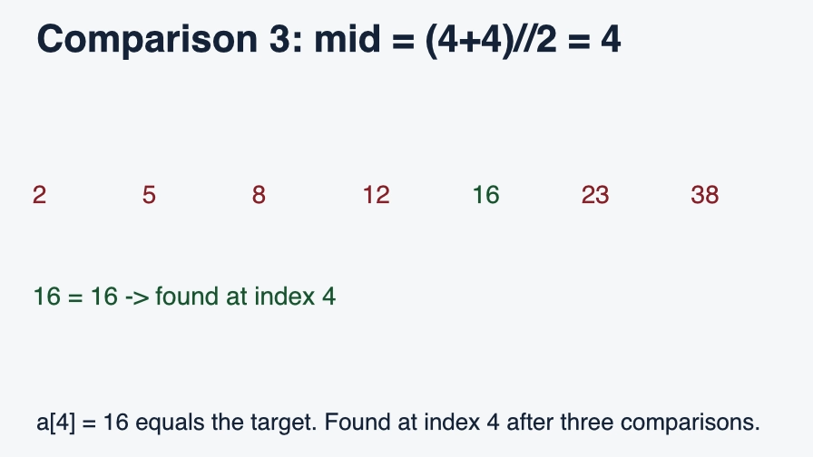

# Raea Explainer for LearnHarness

Create narrated, captioned mathematical animations directly in a LearnHarness lesson. The teacher uses your existing configured model; Raea renders the visual locally. Videos appear in the conversation with playback controls and a text transcript.

## See it in action



[Watch the 15-second example](examples/binary-search.mp4). The teacher generated this plan using an existing Claude connection in the official LearnHarness 0.6.0 app; the enabled plugin rendered it locally with the Light theme. This earlier v0.1 example is silent and captioned; new animations can include local narration.

## Install the prebuilt plugin

Requires **LearnHarness 0.6.0 or later**. Download the [prebuilt plugin ZIP](https://github.com/GoatInAHat/learnharness-raea/releases/download/v0.2.0/raea-explainer.zip) from the [v0.2.0 release](https://github.com/GoatInAHat/learnharness-raea/releases/tag/v0.2.0). In LearnHarness open **Settings → Community plugins** and copy the plugins directory. Extract the archive there, so that this file exists:

```text
<plugins directory>/raea-explainer/dist/manifest.json
```

Refresh the plugin list and enable **Raea Explainer**. No Node.js or npm is needed to install the prebuilt package. Ask your teacher, for example: **“Explain binary search with a short video, then ask me a quick question.”**

The first video card asks permission to download the official Raea runtime. On macOS Apple Silicon this is 303 MiB and uses about 1.1 GiB installed; Linux x64 downloads 961 MiB and Windows x64 downloads 251 MiB, both requiring additional disk space. The fixed release archive is checked against its pinned SHA-256 digest before extraction. Narration additionally requires a one-time 207 MiB local Pocket TTS model download; the card discloses the downloads before they begin. Model files come from pinned revisions and each file is checked for size and SHA-256. Later renders reuse them. Speech synthesis and rendering run offline; no additional AI key is required.

Linux requires a compatible glibc (2.39 or newer), Vulkan graphics, ALSA and fontconfig. Windows requires an x64 Visual C++ runtime and compatible DirectX 12 or Vulkan graphics. The pinned Raea runtime has been exercised on Apple Silicon macOS, Ubuntu 24.04, and Windows Server 2025 with software Vulkan. Full plugin and desktop-app acceptance has been performed on macOS Apple Silicon; CI checks the standalone plugin build, tests, package and installer on Linux and Windows. Graphics drivers and other host requirements can vary. Unsupported architectures cannot render.

## Settings and saved videos

Open **Settings → Community plugins → Raea Explainer** or use **Video settings** on a video card. **Allow new explainer videos** defaults on; turning it off blocks new plans and renders while existing videos remain playable. Choose a maximum length of 10, 15, 25, 45, 60, 90 or 120 seconds for new plans (60 seconds by default for new installations), a dark or light theme, whether to narrate, and the Alba or Marius voice. Existing preferences remain in place after updates. Videos have captions and a transcript; there is no background music.

Disabling the entire community plugin hides its video renderer until it is enabled again. This does not delete the plugin’s saved plans, videos or runtime. To update, replace only `raea-explainer/dist/`, preserve sibling `data/`, and restart LearnHarness. Raea runs as a separate executable, not as model-generated code; the teacher supplies bounded declarative scene data.

## Develop

Node.js 22 or newer is required to build from source:

```sh
npm ci
npm run typecheck
npm test
npm run build
npm run install:local -- "<plugins directory>"
```

The portable installer only replaces `dist/`, preserves `data/`, and never enables plugins or starts the host. Refresh and enable a new install; restart after changing loaded code. The bundled SDK contains generated public, type-only LearnHarness declarations. Runtime JavaScript does not import host-private modules.

### Compare an authored lesson locally

Set the plugin's maximum length to 90 or 120 seconds to make the semantic math tool available to the teacher. The existing shorter tool remains available for other diagram types. The teacher uses the active conversation model.

From a source checkout, pass a [v3 plan](src/semantic-math.schema.json) and an optional cue-aligned PCM narration master to the comparison command. Use a separate output directory for private media.

```sh
npm run compare -- /path/to/plan.json /path/to/comparison.mp4 \
  --archive /path/to/official-raea-rc2-archive --wav /path/to/master.wav
```

The command verifies the pinned archive before use. Omit `--archive` to download it into the temporary comparison directory. Pass `--pocket` to synthesize the plan with the approved local Alba voice, or omit both audio flags to render a silent review. The WAV must be mono 16-bit PCM at 16–48 kHz, span the full lesson, and follow its cue windows. Pass `--no-captions` to hide optional authored captions. This command uses an isolated temporary directory beside the output and does not open LearnHarness.

To make a master for both comparison renders, request a WAV output with `--pocket`. This authorizes the pinned Pocket asset download and runs a local GPU render to capture its pre-encoder audio bounce. The command validates and saves the mono PCM master at the supplied path. Use the same master with `--wav` for subsequent renders.

```sh
npm run compare -- /path/to/plan.json /path/to/master.wav \
  --archive /path/to/official-raea-rc2-archive --pocket
```

## License and attribution

The Pocket TTS model and its tokenizer are downloaded separately under CC BY 4.0; see [THIRD_PARTY_NOTICES.txt](THIRD_PARTY_NOTICES.txt) for attribution and pinned source details. The plugin source is AGPL-3.0-only; see [LICENSE](LICENSE). The bundled TypeBox dependency is MIT licensed; see [THIRD_PARTY_NOTICES.txt](THIRD_PARTY_NOTICES.txt). LearnHarness is an independent project by Amos Blomqvist. Raea is a separate project by shinyobjectz, downloaded from its official release and subject to its own [FSL-1.1-ALv2 license](https://github.com/shinyobjectz/raea/blob/v0.1.1-rc2/LICENSE). This project is not affiliated with either upstream.
